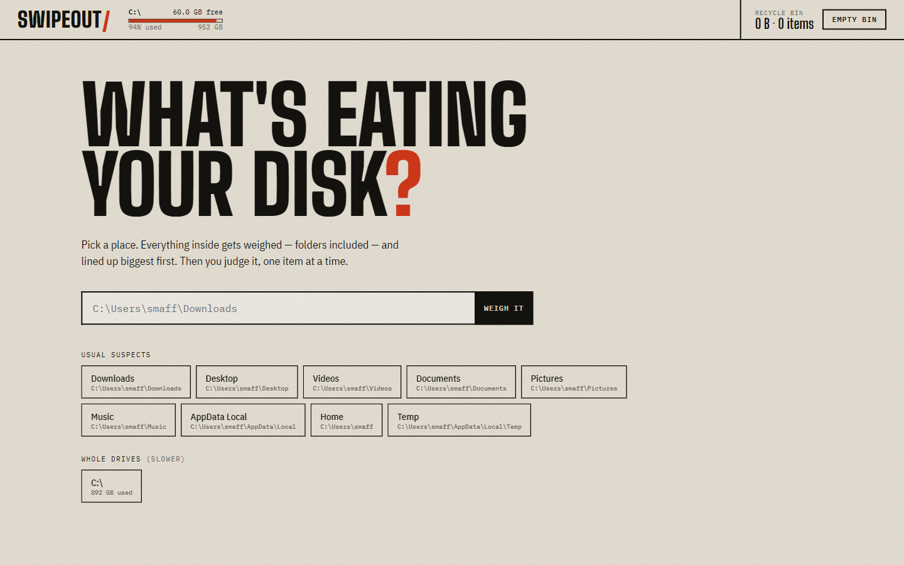
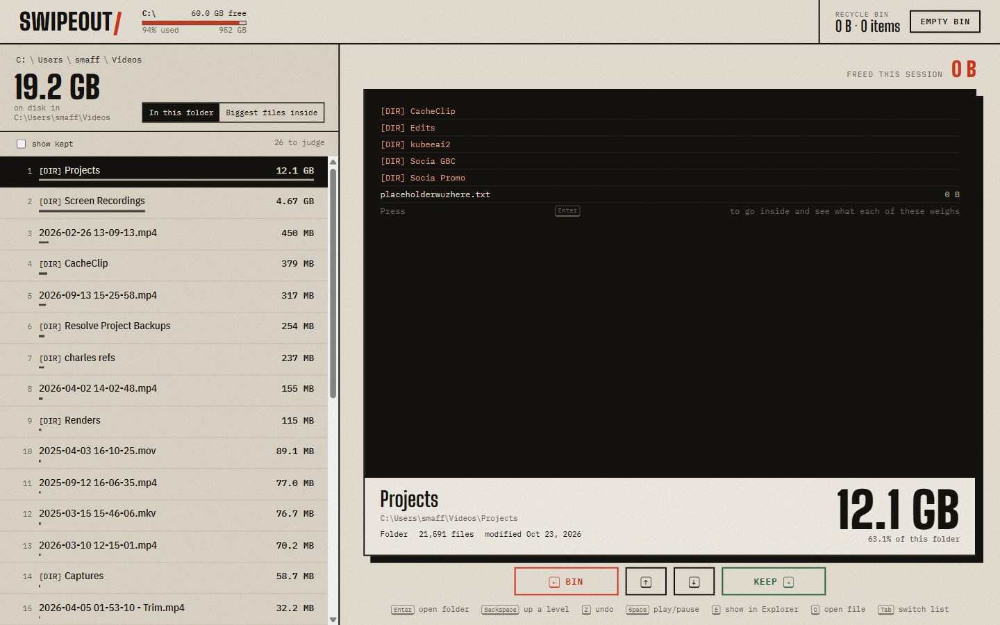

# Swipeout

**Windows Swipe Storage Cleaner**

Swipe Cleaner for iPhone, but for your Windows PC — and free, open source, no subscription, no tracking, runs 100% locally.



## Why

Windows Explorer won't tell you how big a folder is. So the 40 GB eating your disk hides three levels deep while you guess. Swipeout weighs everything — folders included — lines it up biggest first, and lets you judge it one item at a time: left to bin, right to keep, like a dating app for your own files.



## Features

- Real recursive folder sizes, sorted biggest first — with live byte counts while it scans
- Rich previews: images, video (with seeking), audio, PDF, text, zip contents, and folder thumbnails
- Swipe-style triage: left to bin, right to keep
- 4-second undo window on every bin
- PC deletes go to the Recycle Bin, not the void
- Protected system paths — Windows, Program Files, drive roots, and other load-bearing folders can't be binned
- Android phones over USB/MTP, hidden dot folders included (that's where the multi-GB thumbnail caches live)
- No installer, no account, no cloud. A small Python server plus a static page

## Keyboard

| Key | Action |
| --- | --- |
| `←` / `A` | Bin it |
| `→` / `D` | Keep it |
| `↑` `↓` / `W` `S` | Move through the list |
| `Enter` | Open folder |
| `Backspace` | Up a level |
| `Tab` | Switch list: folder children vs. biggest files |
| `Space` | Play / pause media |
| `E` | Reveal in Explorer |
| `O` | Open file |
| `Z` | Undo last bin |
| `R` | Rescan |
| `Esc` | Cancel scan |

## Quick start

Requires **Windows** and **Python 3** (tested on 3.13).

```sh
git clone https://github.com/smaffan21/swipeout.git
cd swipeout
pip install -r requirements.txt   # optional — only for phone support
python server.py
```

Or just double-click `Swipeout.bat`. Your browser opens to http://127.0.0.1:8765 — pick a folder or drive and start swiping.

Change the port with `SWIPEOUT_PORT=9000 python server.py`.

## Phones over USB

Swipeout can triage an Android phone plugged in over USB:

1. Unlock the phone and set the USB connection to **File Transfer / MTP**.
2. It shows up in the app next to your drives. Scan and swipe like any other folder.

Two honest warnings:

- **Phone deletes are permanent.** There is no Recycle Bin over MTP. `Z` still cancels a delete during the 4-second countdown, but once it fires the file is gone.
- **Samsung Secure Folder and app-private data aren't reachable over USB.** That's Android's sandbox doing its job, not a bug. Swipeout shows exactly what Windows can see.

## Safety and privacy

- Binds to `127.0.0.1` only — nothing on your network can reach it
- Rejects requests with a foreign `Host` header and POSTs without its custom header, so a random webpage can't drive it
- Makes zero network calls and collects zero telemetry — the only traffic is between your browser and localhost
- PC deletes use the Windows Recycle Bin (`FOF_ALLOWUNDO`), so you can fish things back out
- Protected paths (system folders, drive roots, core user folders) refuse to be binned

## License

[MIT](LICENSE)
