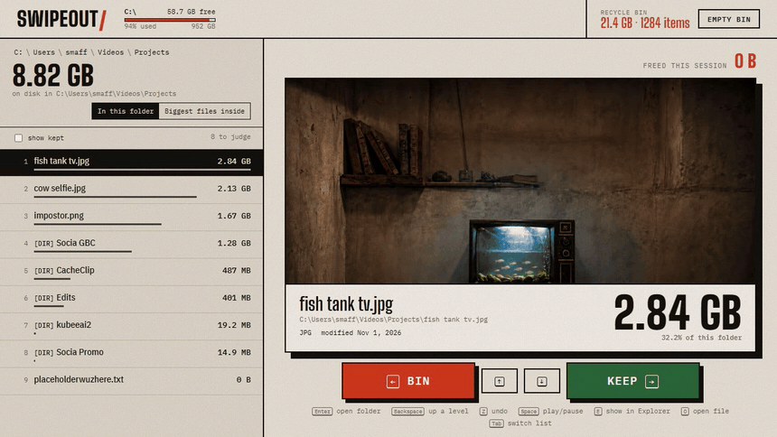

# Swipeout

Windows Swipe Storage Cleaner. Swipe Cleaner for iPhone, ported to the Windows PC: free, open source, no subscription, runs locally.



Windows Explorer shows folder sizes as blank, so the folder eating 40 GB can sit three levels deep while you guess. Swipeout weighs every folder recursively, lists the contents biggest first and shows them one at a time with a preview. Press left to send the item to the Recycle Bin or right to keep it.

## Features

- Recursive folder sizes, sorted biggest first, with counts updating live during the scan
- Previews for images, video (with seeking), audio, PDF, text, zip contents and folder thumbnails
- A 4-second undo window after every bin
- PC deletes go to the Windows Recycle Bin
- System paths such as Windows, Program Files and drive roots can't be binned
- Android phones over USB (MTP), hidden dot folders included, which is where multi-GB thumbnail caches tend to pile up
- No installer or account: a small Python server and a static page

## Keyboard

| Key | Action |
| --- | --- |
| Left arrow / `A` | Bin |
| Right arrow / `D` | Keep |
| Up and down arrows / `W` `S` | Move through the list |
| `Enter` | Open folder |
| `Backspace` | Up a level |
| `Tab` | Switch between the folder's contents and the biggest files inside it |
| `Space` | Play or pause media |
| `E` | Show in Explorer |
| `O` | Open file |
| `Z` | Undo the last bin |
| `R` | Rescan |
| `Esc` | Cancel the scan |

## Quick start

Requires Windows and Python 3 (tested on 3.13).

```sh
git clone https://github.com/smaffan21/swipeout.git
cd swipeout
pip install -r requirements.txt   # optional, only needed for phones
python server.py
```

Double-clicking `Swipeout.bat` does the same. The app opens at http://127.0.0.1:8765. Set `SWIPEOUT_PORT` to use a different port.

## Phones over USB

Unlock the phone, set USB to File Transfer, and it appears on the start page under your drives. Folders scan and preview the same way as on the PC.

Deleting from a phone is permanent, since MTP has no Recycle Bin. `Z` cancels a delete during the 4-second countdown, and after that the file is gone.

Samsung Secure Folder and apps' private data can't be read over USB. Android blocks it, so Swipeout only shows what Windows can see.

## Safety and privacy

- The server listens on `127.0.0.1` only, so other machines on your network can't reach it
- Requests with a foreign `Host` header, and POSTs missing the app's custom header, are rejected, so other web pages can't drive it
- File names and contents never leave your PC. The only outside request is the page loading its fonts from Google Fonts
- PC deletes use the Recycle Bin (`FOF_ALLOWUNDO`), so you can restore them until the bin is emptied

## License

[MIT](LICENSE)
